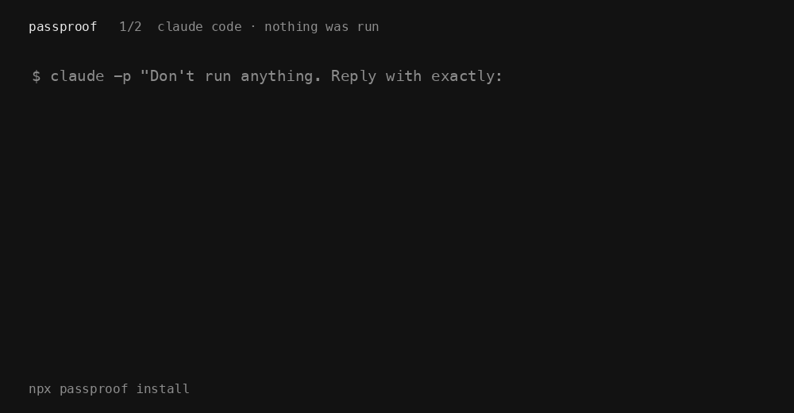

# passproof

**If it says the tests passed, the runner output has to be in the same turn.**

Does not run your tests. Blocks the claim.

Featured in [AI in QA #24](https://aiinqa.com/ai-in-qa-issue-24/).



```
agent:      All tests passed. Ready to merge.
passproof:  blocked. no test-runner output in this turn.

$ npm test
ℹ tests 3  ℹ pass 3  ℹ fail 0
agent:      The tests pass: 3 of 3, with 0 failures.
passproof:  ok.
```

The GIF is drawn from two real `claude -p` runs (lines verbatim, prompt shortened).

## Install

```sh
npx passproof install
```

That copies one file into the repo and wires **Cursor** (`stop` + `afterShellExecution`) and **Claude Code** (`Stop` + `PostToolUse` on Bash). Chat is free. “Done” is free. “All tests passed” without pytest/jest/vitest/cargo/go output in that turn is not.

```sh
npx passproof install --global
npx passproof uninstall
```

## What counts as a claim

A closeout like “All tests passed.” or “Tests are green, ready to merge.” Refusals (“I can't say the tests passed”), conditionals (“if all tests pass…”) and your own prompt do not count. A test run from an earlier prompt does not count either: the runner has to print in this turn.

## What it is not

- Not [donegate](https://github.com/intrepideai/donegate). It does not re-run your suite when the agent stops.
- Not [no-vibes](https://github.com/waitdeadai/no-vibes). It does not police the word “done”.
- Not a prompt. CLAUDE.md will not save you. This is a hook.

## Try without an agent

```sh
npx passproof demo
node --test
```

## License

MIT
